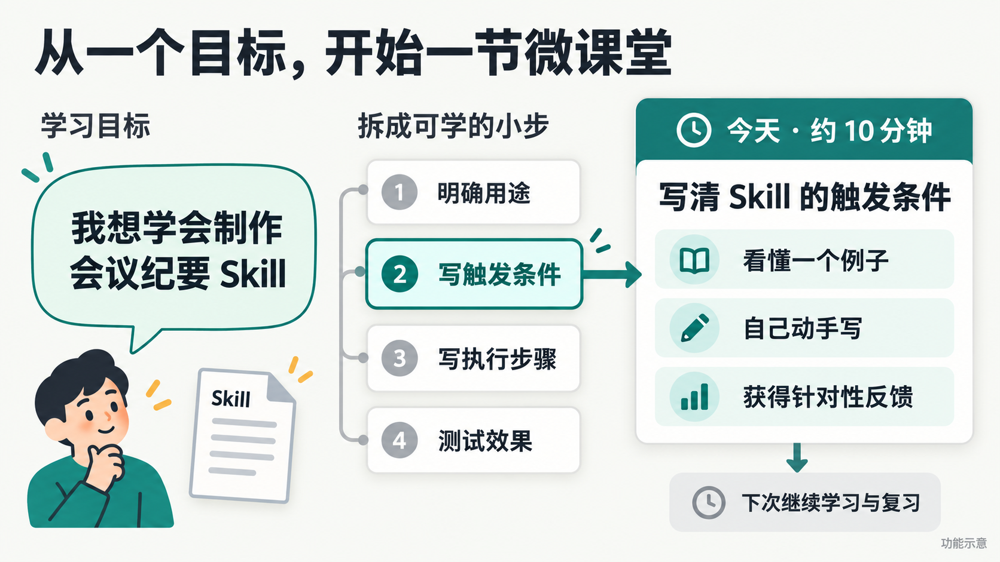
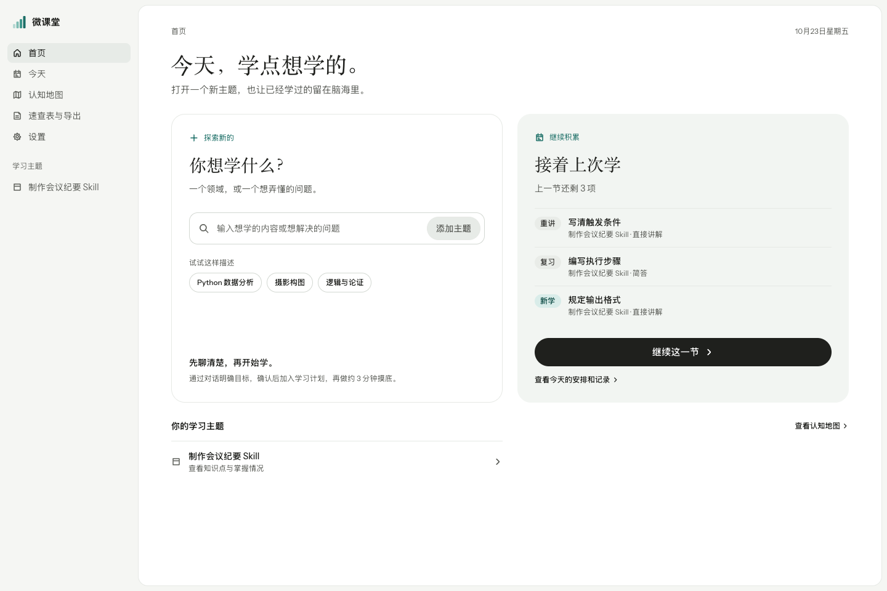
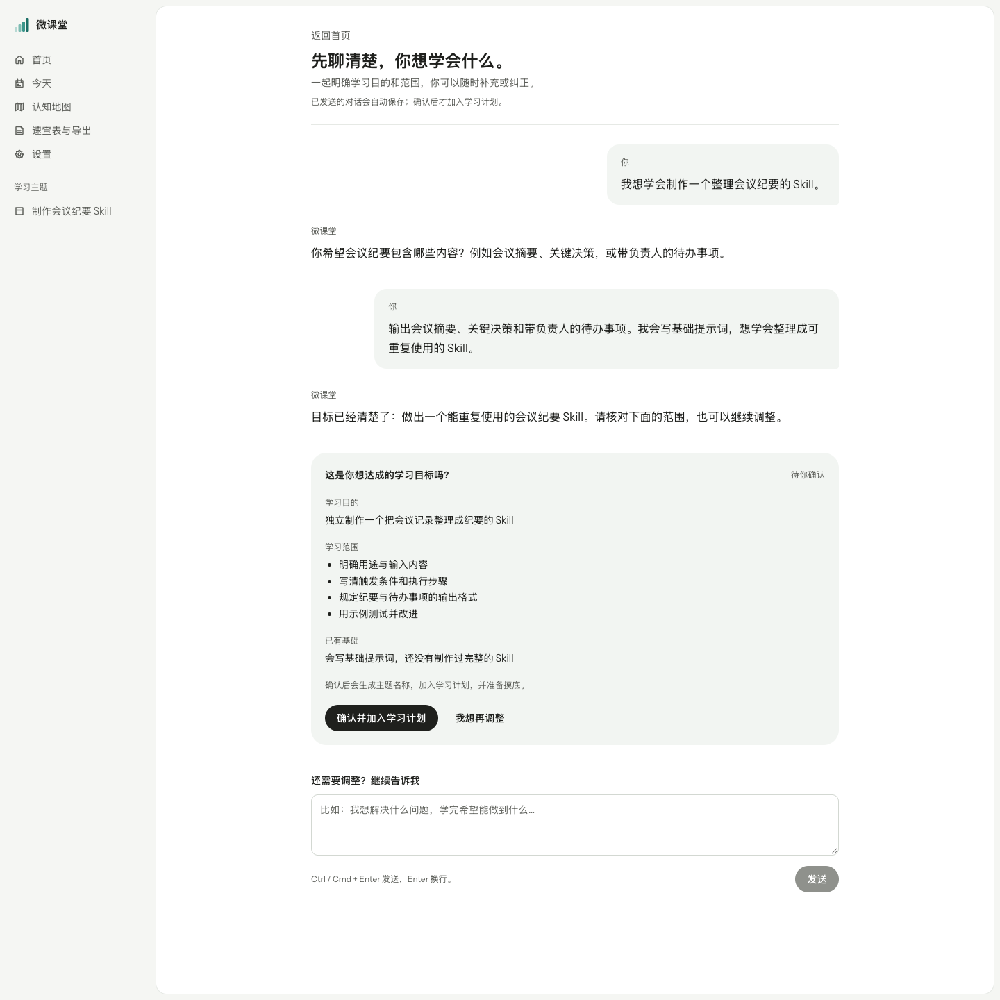
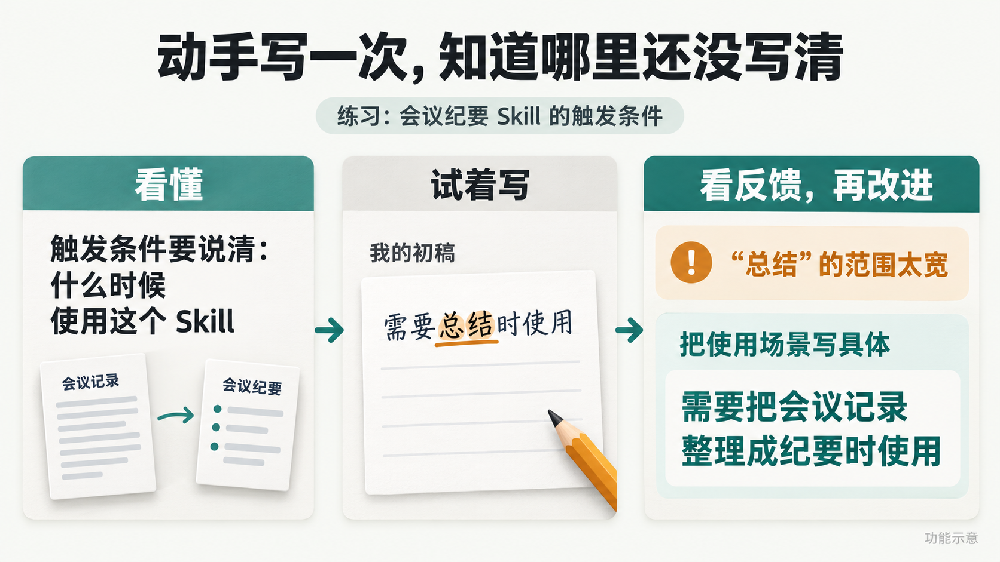
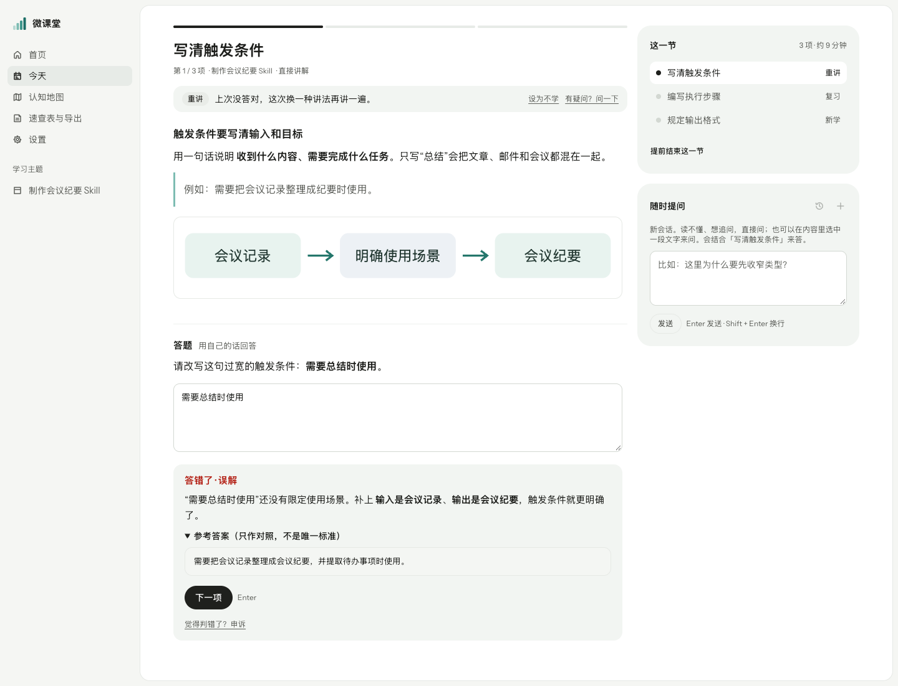
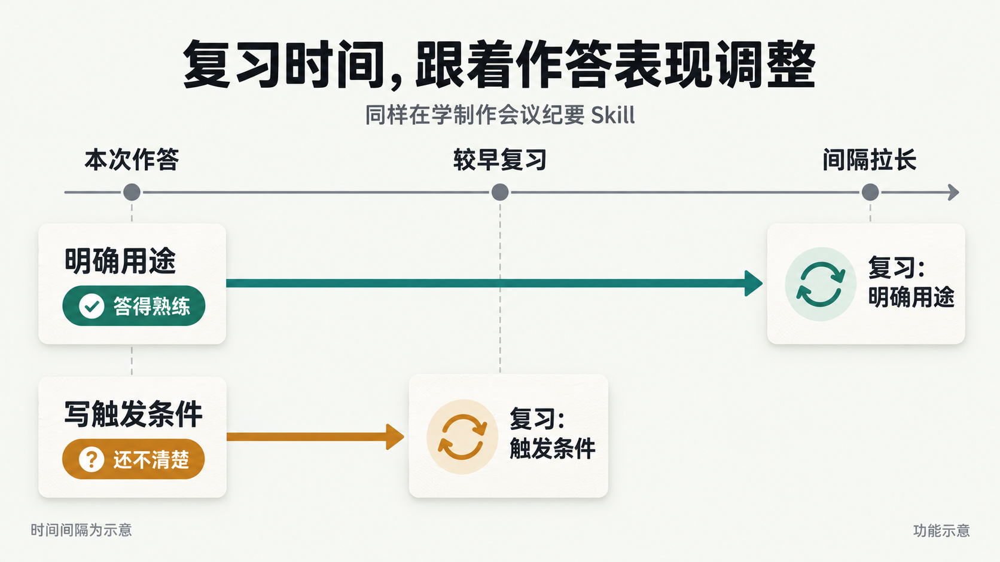
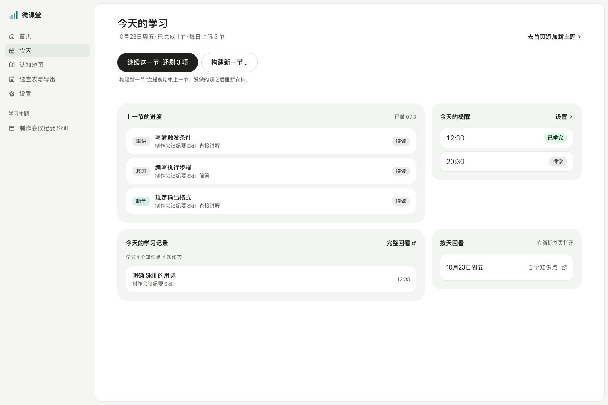
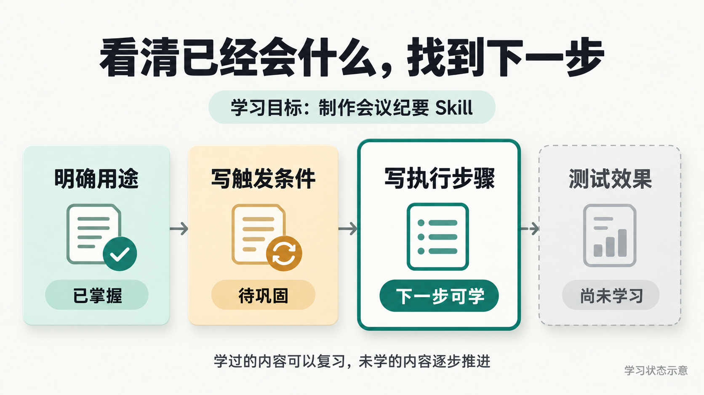
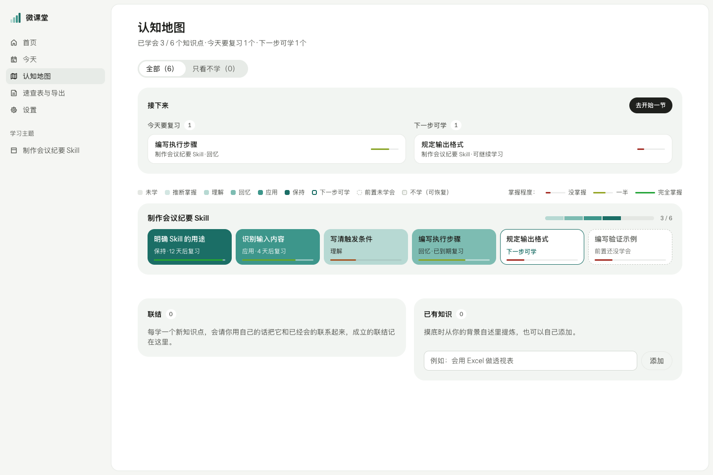

# mini-classroom · 微课堂

**说出你想学什么，从一节约 10 分钟的学习开始。**

微课堂把你想学的内容拆成小步，准备讲解和练习，再根据作答安排复习。你可以把时间用在**理解、练习和提问**上，少花精力决定“今天学什么、什么时候复习”。

**本机运行 · 自选 AI 模型 · 学习记录保存在自己的电脑**

[看看能帮你做什么](#你能得到什么) · [开始使用](#开始使用) · [参与开发](#参与开发)



<details>
<summary>查看首页截图</summary>



</details>

## 你能得到什么

### 1. 从一个想法，找到学习起点

先说出想解决的问题，不用准备完整的学习计划：

> 我想学会制作一个 Skill，把会议记录整理成会议纪要。

AI 会和你聊清楚**学来做什么、已经会什么、这次学到哪里**。你确认范围后，再开始准备学习内容。

做一次摸底，可以减少重复学习已会的内容。也可以跳过，直接从基础开始。

<details>
<summary>查看学习目标澄清页截图</summary>



</details>

### 2. 用一小段时间，学一点、练一下

打开微课堂，先看这一节的安排。默认约 **10 分钟**，也能调整时长；系统会穿插复习、正在学的内容和新知识。

- **看懂一个要点**：通过例子、类比或图解理解它。
- **试试自己会不会**：回答选择题、简答题，或完成补全、修正练习，并查看反馈。
- **把没懂的地方问清楚**：直接追问，或选中一段内容提问，不用切换到其他聊天工具。



<details>
<summary>查看学习与作答反馈截图</summary>



</details>

### 3. 让系统记住该复习什么

**不用自己维护复习日历。**微课堂根据作答和自评，安排知识点下次出现的时间。答错后更早复习，掌握较稳后再拉长间隔。

有内容需要巩固时，它会进入后续学习安排。再次打开，就能继续练习。



<details>
<summary>查看今天的学习安排截图</summary>



</details>

**觉得 AI 判错了，可以申诉。**发现已经学过的内容没弄懂，也能主动选择重新学习。

### 4. 看清学到哪，按自己的节奏继续

打开认知地图，就能一起查看不同主题的学习情况：**已经学会什么、今天该复习什么、下一步能学什么**。



<details>
<summary>查看认知地图截图</summary>



</details>

点开知识点，可以回看自己怎么答、哪里答错，以及用自己的话建立的知识联系。暂时不想学的内容可以排除，想继续时再恢复。

### 5. 需要用时，找回学过的内容

不用从头翻阅全部学习记录。按主题生成**速查表**，集中查阅常用概念和容易混淆的地方。

想放进自己的笔记工具时，可以将知识点、作答记录和速查表**导出为 Markdown**。

## 开始使用

**先准备：Node.js 24.x，以及模型服务的接口地址、模型名称和 API 密钥。**

支持 macOS / Linux；Windows 请在 WSL 中运行，原生 Windows 未验证。

### 第一步：安装并启动

克隆仓库或下载源码，进入含 `package.json` 的项目目录，运行：

```bash
npm install --global pnpm@10.11.0
pnpm install --frozen-lockfile
pnpm start
```

打开终端打印的页面地址。默认是 `http://127.0.0.1:6101`；端口被占用时会自动顺延，以实际输出为准。

### 第二步：连上自己的 AI 模型

打开 **设置 → AI 模型**，填写连接信息，测试成功后保存。

- 支持 **OpenAI 兼容接口、Anthropic、Google** 三类格式，实际模型以服务商支持为准。
- 使用 OpenAI 兼容接口时，填写完整基础地址，通常包含 `/v1`。
- **图像模型可以先留空**。不配置它，也能使用文字讲解和代码图解。

高级配置和 `.env` 用法见 [开发指南](docs/development.md#环境配置)。设置页保存的配置优先于环境变量。

### 第三步：完成第一节微课堂

1. **选一个主题**：在首页输入想学的内容，和 AI 聊清楚目标后确认。
2. **确定起点**：等待内容生成，完成或跳过摸底。
3. **开始学习**：跟着讲解完成练习，答对后按自己的感受选择自评。

学完后，到“今天”查看安排，或去认知地图回看所学。首次生成、内容不足或临时改变学习要求时，需要等待模型响应。

**用完后停止服务：**

```bash
pnpm stop
```

停止不会删除学习记录。修改 `.env` 后，用 `pnpm restart` 重启。

## 使用前知道这 4 件事

1. **关闭网页不等于停止计费。**后台准备学习内容时仍可能调用付费模型。暂时不用，请运行 `pnpm stop`。
2. **模型需要处理你的学习内容。**主题、作答等内容会发送到你配置的服务；设置页保存的密钥在本机数据库中明文存储。页面也会加载 Google Fonts，详见 [安全说明](SECURITY.md)。
3. **目前只供本人在本机使用。**没有登录认证，请勿直接开放到局域网或公网。提醒需授权并保持页面或应用运行；不支持离线学习，也不能只靠 GitHub Pages 运行完整应用。
4. **AI 的讲解和批改可能有误。**遇到疑问可以追问、申诉或核对资料。

学习数据默认位于 `data/weiketang.sqlite`。不要公开 `.env`、`data/`、`.run/`，分享导出文件前也要检查其中的个人内容。

## 参与开发

项目使用 **React + TypeScript、Node.js + Hono、SQLite**。业务规则、模型调用、数据存储和页面分别组织，目录说明见 [开发指南](docs/development.md#目录职责与依赖方向)。

修改后运行：

```bash
pnpm check
```

它会执行类型检查、自动测试和前端构建。测试使用模拟模型和内存数据库，**不需要真实密钥，也不会改写你的学习记录**。

- [开发指南](docs/development.md)：环境配置、目录职责、迁移和测试。
- [贡献指南](CONTRIBUTING.md)：报告问题、提出需求和提交修改。
- [领域术语](CONTEXT.md)：了解“知识图谱”“认知地图”等概念。
- [发布检查](docs/releasing.md)：当前核查结果与待办。

## 许可

原创代码采用 [MIT 许可证](LICENSE)，版权署名为 **pipdax**。

第三方依赖与材料的许可说明见 [第三方说明](THIRD_PARTY_NOTICES.md)。
